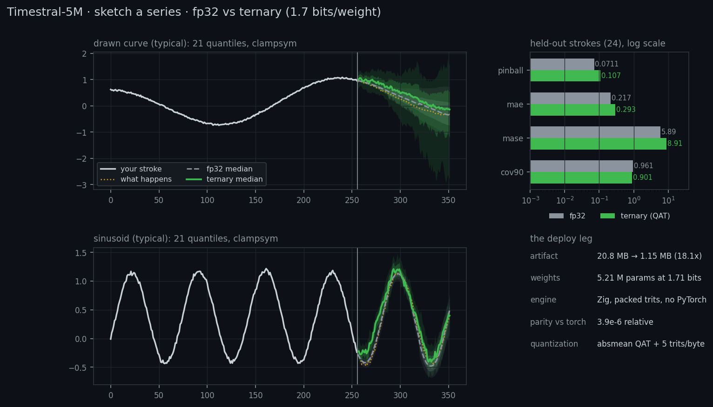

# Timestral-5M, deployed and ternarized

- **Applies to:** `main` as of v0.2.0
- **Last verified:** 2026-10-30
- **Verification:** `make timestral-check` (parity against PyTorch), `make timestral-eval` (regenerates every number below)

Two questions drove this example:

1. **Can this repository deploy someone else's model?** Timestral-5M is Mistral AI's
   5.2 M-parameter time-series foundation model. The task was to stand it up locally behind
   a *sketch-a-series* app — draw a stroke with the mouse, the model continues it as a fan
   of quantiles, like [the Space](https://huggingface.co/spaces/townbox/sketch-a-series).
2. **What does this repository's quantization stack do to it?** Absmean ternarization,
   5 trits per byte, a packed artifact and a Zig deployment engine were built for models
   this project trains itself. Turned on a pretrained transformer they cost 1.15 MB of
   weights instead of 20.8 MB — if the forecasts survive.

The short answer: after quantization-aware fine-tuning, 1.77 bits per weight costs
**0.107 pinball against 0.071 for fp32** on the same strokes, recovering 73 % of what naive
post-training ternarization threw away. The Zig engine reproduces PyTorch to 2.4·10⁻⁶
relative error on the fp32 weights, so that gap is quantization, not a porting bug.



## The model

| | |
| --- | --- |
| source | [`mistralai/Timestral-5M`](https://huggingface.co/mistralai/Timestral-5M) (Modified MIT weights, Apache-2.0 code) |
| parameters | 5,208,960 |
| architecture | 8 patch-transformer blocks, d_model 192, 3 heads, SwiGLU 512, 32-step patches |
| attention | time attention with RoPE over `[Enc ; Dec]` patches, variate attention on two of the eight layers, sigmoid output gates |
| output | 21 quantiles (0.01 … 0.99), monotone by construction, per time step |
| context | up to 32,768 steps; one decode block is 32 patches = 1,024 steps |
| inference | fp32, CPU, no GPU needed |

The reference implementation is vendored under
[`reference/timestral/`](../reference/timestral) (`model.py`, `layers.py`, `masks.py`,
`scaler.py`, `forecaster.py` from the upstream repository), so the parity tests and the
fp32 backend run without network access.

Two details matter for everything that follows:

- **Decoupled Horizon Forecasting.** The context is embedded as patches, forecast-query
  tokens are appended, and every query token reads the context through a causal mask while
  reading its own causal chain inside the horizon. One forward pass produces a whole block
  of 32 patches; the forecast is not autoregressive step by step.
- **The advancing refine frame.** The head denormalizes the block in the frame of the last
  context patch, then each later horizon patch is re-denormalized in a frame that folds in
  the block's earlier medians. That re-framing is a Welford scan in float64, and the Zig
  engine reproduces it (`src/timestral/engine.zig`).

## 1. Deploy: the fp32 model behind a drawing app

```bash
python deploy/app.py            # http://127.0.0.1:8000
```

`deploy/app.py` is a FastAPI front end with two interchangeable backends; the page is one
self-contained HTML file (`web/sketch-a-series.html`). The page resamples the ink to a
uniform time grid, sends `{"y": [...], "h": 96}`, and paints the `(96, 21)` answer as a fan
with a median line — while the finger is still moving, throttled to one request per 120 ms
and with stale responses dropped.

The fp32 backend runs Mistral's checkpoint through the reference `timestral` package. The
ternary backend talks JSON lines to `timestral-cli serve`, which loads the packed artifact
and runs the Zig engine — no PyTorch in that process at all.

### The Zig engine vs PyTorch

The engine is a full port of the forward pass, not an approximation. Three independent
checks:

| check | what it compares | result |
| --- | --- | --- |
| stage dump (`zig build test`) | 13 intermediate tensors of one decode block: normalized patch embedding, every layer output, final norm, quantile head, denormalized block | worst relative difference **1.4·10⁻⁵** |
| whole block | full `(3, 96, 21)` output after clampsym, refine frames and capping | max abs difference **3.9·10⁻⁵** on a magnitude of 8.3 |
| batch + metrics (`make timestral-check`) | 24 strokes through PyTorch and through the Zig engine, metrics recomputed by a third (NumPy) implementation | max relative error **2.4·10⁻⁶**, metrics agree to **2·10⁻⁷** |

A fourth check rebuilds the *deployed* weights from the packed artifact in NumPy, loads them
into PyTorch, and re-runs the forecast: `python/timestral_check_artifact.py` reports
**3.7·10⁻⁶** relative agreement with the Zig engine, which pins the packer and the unpacker
as well.

## 2. Quantize with this framework

`timestral-cli quantize` is the whole deployment leg:

```
fp32 safetensors ──► per-row absmean ternarization ──► 5 trits/byte ──► packed artifact
                       (framework/quant.zig)          (framework/ternary.zig)
```

The quantizer is the one this repository uses for its own models: `scale = mean(|row|)`,
`trit = +1` past `scale/2`, `−1` below `−scale/2`, `0` in between, and the deployed weight is
`scale · trit`. Norms, the forecast query and the patch-embedding biases stay fp32
(4,992 parameters); every projection — attention, gates, SwiGLU, patch embedding, quantile
head, 52 matrices — becomes ternary.

| | fp32 | ternary |
| --- | --- | --- |
| weights | 20,843,960 B | **1,152,070 B** |
| bits per parameter | 32 | **1.77** |
| trit histogram | — | −1 32.5 %, 0 35.1 %, +1 32.4 % |

### Naive ternarization is not enough

On the same 24 strokes:

| variant | pinball | MAE | MASE | 90 % coverage |
| --- | --- | --- | --- | --- |
| fp32 | 0.0711 | 0.217 | 5.89 | 0.961 |
| PTQ (per-row absmean, no training) | 0.2023 | 0.522 | 17.55 | 0.777 |
| **QAT** | **0.1071** | **0.293** | **8.91** | **0.901** |

(`python/timestral_probe.py` and `python/timestral_sensitivity.py` look at the collapse from
other angles: one scale per tensor is worse than one per row, and keeping any single group
of layers in fp32 does not rescue naive PTQ — the damage is spread across the stack.)

### QAT: the framework's quantizer in the training loop

`python/timestral_qat.py` fine-tunes the released checkpoint with the *same* quantizer in the
forward pass: `W_q = scale · trit` computed from the fp32 latents every step, straight-through
gradients back to the latents, and the loss is the model's own pinball loss on a corpus of
drawn-looking strokes — hand-drawn curves, periodic strokes, trends, random walks, plateaus,
AR processes, spike trains. Held-out strokes, `h = 96`, clampsym on:

| model | pinball | MAE | 90 % coverage |
| --- | --- | --- | --- |
| fp32 | 0.0983 | 0.284 | 0.921 |
| PTQ (per-row absmean) | 0.2300 | 0.611 | 0.751 |
| **QAT, 2,500 steps** | **0.1143** | **0.316** | **0.799** |

**QAT recovers 88 % of the PTQ gap** on that held-out set and **73 %** on the app's strokes,
for 9.5 minutes of CPU fine-tuning (2,500 steps × 0.23 s on four threads).

Three findings worth recording:

- **The gradient mask matters, and not the way BitNetMCU says.** The framework's
  `maskGrads` freezes gradients where `|W| ≥ scale`. Training from scratch that is fine;
  fine-tuning a pretrained model it freezes almost every weight that carries signal, and the
  ternary model never recovers the amplitude of oscillating strokes (pinball 0.121 vs 0.107
  without the mask). The example keeps plain STE by default and `--mask` reproduces the
  masked variant.
- **A quantized quantile head is overconfident.** After ternarization the 90 % band covers
  74–78 % of the outcomes. One scalar on the quantile increments, fitted on a *calibration*
  split (96 strokes, seed 777) and carried in the artifact (`width_scale = 1.40`), brings
  coverage to 0.90 — and on that split it is also the pinball optimum (0.1269 against 0.1313
  at 1.0). `timestral-cli quantize` picks it with a coverage-targeted rule: the smallest scale
  that reaches ~90 % coverage without giving away more than 2 % of the pinball loss.
- **Mixed precision is not a post-hoc lever.** Keeping, say, the quantile head in fp32 after
  QAT makes the model *worse*, not better (pinball 0.85): the fine-tune trains the trit
  pattern, so the fp32 latents of a ternarized layer are not a working fp32 layer
  (`python/timestral_mixed.py`). A mixed artifact has to be trained mixed.

## 3. The same app test

The application test *is* the app: the same 24 held-out strokes (256 context steps, 96-step
horizon) go through both backends of the running page, and the forecasts they return are
compared. Both answer the identical `POST /api/forecast` request, so nothing is a separate
evaluation path.

| | fp32 (PyTorch) | ternary (Zig, 1.77 bit) |
| --- | --- | --- |
| pinball ↓ | 0.0711 | 0.1071 |
| MAE (median) ↓ | 0.217 | 0.293 |
| MASE ↓ | 5.89 | 8.91 |
| 90 % interval coverage | 0.961 | 0.901 |
| beats persistence | 79 % | 75 % |
| latency, one stroke (on the page) | 31–44 ms | **16–22 ms** |
| latency, 24 strokes batched | ~17–20 ms/stroke | ~17–20 ms/stroke |
| artifact | 20.8 MB | **1.15 MB** |

Per stroke family (pinball, lower is better):

| family | strokes | fp32 | ternary | ratio |
| --- | --- | --- | --- | --- |
| drawn curve | 5 | 0.0619 | 0.1755 | 2.84× |
| sinusoid | 5 | 0.0173 | 0.0386 | 2.23× |
| random walk | 5 | 0.1305 | 0.1277 | 0.98× |
| trend + noise | 5 | 0.0117 | 0.0127 | 1.09× |
| plateaus | 4 | 0.1496 | 0.1994 | 1.33× |

The pattern is consistent with the visual: monotone or noisy strokes survive quantization
essentially intact, while strokes whose continuation needs a well-preserved *amplitude* —
drawn curves and sinusoids — come out visibly damped. That is the cost of 1.77 bits per
weight, and the page draws both medians on top of each other so it is visible rather than
hidden.

## Reproduce

```bash
make fetch-timestral                  # checkpoint + reference fixtures (21 MB)
zig build --release=fast              # timestral-cli
make timestral-qat                    # QAT fine-tune (9.5 min on 4 threads)
make quantize-timestral               # QAT latents -> packed artifact (+ width calibration)
make quantize-timestral-ptq           # released checkpoint -> plain-PTQ artifact (baseline)
make timestral-eval                   # fp32, PTQ and ternary scores on 24 strokes
make timestral-check                  # end-to-end parity against PyTorch
python python/timestral_check_artifact.py   # dequantize the artifact, re-run PyTorch
python python/timestral_table.py      # the per-family table above
python python/timestral_figure.py modeldata/timestral_forecast_fp32.bin \
    modeldata/timestral_forecast_ternary.bin docs/timestral-sketch.png
make sketch                           # the app, both backends
```

## Limitations

- **Univariate, no covariates.** The app draws one curve per stroke; the engine implements
  the context-only path of the model (single variate, no past/known covariates). The
  multivariate and covariate paths of the reference are not ported.
- **One decode block.** Horizons up to 1,024 steps are handled in one pass; the reference's
  block-autoregressive loop for longer horizons is not implemented. The app asks for 96 or
  192 steps.
- **Quantization is distribution-aware.** QAT fine-tunes on drawn-looking strokes, which is
  what the app receives. A different domain would want its own corpus; the naive-PTQ row
  shows what happens without one.
- **The fine-tune is not free even in fp32.** The QAT latents evaluated without quantization
  score 0.0769 against 0.0711 for the released checkpoint: fine-tuning on a narrow stroke
  distribution costs ~8 % even before any trit is applied.
- **fp32 stays available.** The app keeps the fp32 backend, which is the honest way to see
  what the quantization cost.

## Files

```
web/sketch-a-series.html     the drawing app (one file, no dependencies)
deploy/app.py                FastAPI: two backends behind one /api/forecast
deploy/README.md             run instructions and the API contract
src/timestral/model.zig      the network: patch embedding, attention, RoPE, SwiGLU, head
src/timestral/engine.zig     padding, clampsym, advancing refine frame, capping
src/timestral/weights.zig    safetensors loading + the framework's absmean quantizer
src/timestral/artifact.zig   the packed artifact (config, fp32 tensors, pinned trits)
src/timestral/eval.zig       stroke corpus + pinball/MASE/coverage
src/timestral/fixture.zig    reader for the PyTorch reference dumps
examples/timestral_sketch.zig  CLI: quantize / eval / forecast / serve + parity tests
python/timestral_qat.py      quantization-aware fine-tuning
python/timestral_fixtures.py dumps the reference intermediates the parity test uses
python/timestral_parity.py   whole-forecast parity against PyTorch
python/timestral_check_artifact.py  dequantize the artifact and re-run PyTorch on it
python/timestral_metrics.py  the metric definitions used by every script
python/timestral_probe.py    what naive ternarization costs (per-tensor vs per-row)
python/timestral_sensitivity.py  which layer groups tolerate ternary
python/timestral_mixed.py    fp32/ternary mixtures after QAT (why they do not work)
python/timestral_widths.py   the quantile-width sweep behind the calibration
python/timestral_table.py    the per-family table
reference/timestral/         vendored upstream inference package
```
